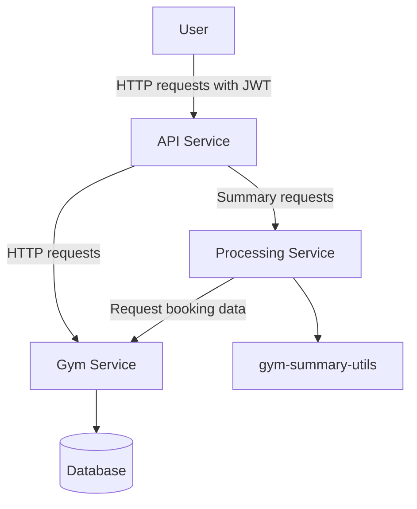
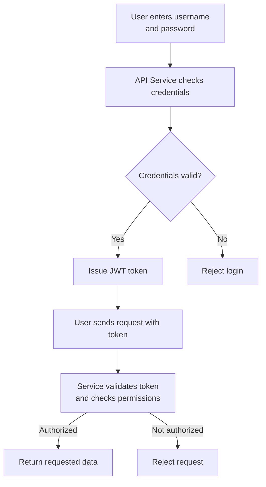

# System Architecture — Gym Management System

## 1. Overview
The system lets members view gym classes, make bookings, and view their own bookings. Admins can create classes.

## 2. Components
The system has three separate Python services that communicate through HTTP:

- **API Service:** Handles login, issues JWT authentication tokens, and receives user requests.
- **Gym Service:** Manages classes and bookings and checks user permissions.
- **Processing Service:** Creates booking summaries using my own helper package, `gym-summary-utils`.

The helper package will be installed separately and used by the Processing Service.

## 3. Architecture Diagram

The three services run as separate processes. The database and helper package are not counted as application components.

## 4. Authentication Flow

After logging in, the user receives a JWT token. Later requests include this token. The relevant service must validate the token and check the user's permissions before allowing access.

## 5. Trust Boundaries

- **User → API:** Check login details, tokens, and input.
- **API → Gym Service:** Check permissions before allowing access to bookings or classes.
- **API → Processing Service:** Check that users are allowed to request summaries.
- **Services → Database:** Use parameterized queries and protect private data.
- **Processing Service → Helper Package:** Track the dependency and check for known vulnerabilities.

Services must not automatically trust requests just because they come from another service.

## 6. Users and Permissions

The system has two roles:

| Action | Member | Admin |
|---|---|---|
| View classes | Yes | Yes |
| Make bookings | Yes | Yes |
| View own bookings | Yes | Yes |
| View another user's bookings | No | No |
| Create classes | No | Yes |
| Generate own summary | Yes | Yes |

Test accounts:
- Alice — member
- Bob — member
- Admin — administrator

## 7. Security Principles

- **Least privilege:** Members cannot use admin-only features.
- **Complete mediation:** Check permissions whenever protected data is accessed.
- **Fail-safe defaults:** Reject requests when authorization is missing or invalid.

I will test these principles using automated tests.

## 8. Scope

This is a local security assignment, not a public production system. No graphical interface is required; I can test the application using HTTP requests and automated tests.

The project will demonstrate three vulnerabilities from the course catalogue and one additional vulnerability caused by the services working together. I will document the vulnerabilities, fix them, and test that the fixes work.